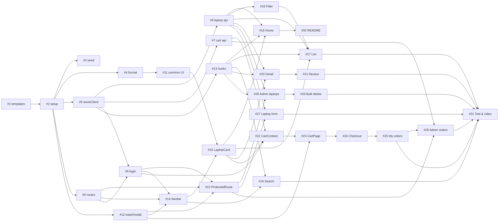

# Assignment_readme.md — LaptopStore: đề bài & 31 issue cho nhóm 3 người

> **Dự án:** LaptopStore (`laptop-store`) — Exercise 27 mở rộng, FER202
> **Hướng dẫn thao tác:** `Assignment_guide.md`
> **Nhóm 3 người:** **A** (Leader — khởi tạo repo, tầng API lõi, đăng nhập/phân quyền, routing, quản trị laptop, release) · **B** (Catalog — khách xem hàng) · **C** (Commerce — giỏ hàng, đơn hàng, form quản trị, kiểm thử)
> **Công nghệ:** React + Vite · react-bootstrap + bootstrap 5 · react-router-dom 6 · axios · json-server 0.17.4 · concurrently

Tài liệu này là **đề bài cho nhóm**: chia Exercise 27 mở rộng thành **31 issue**, phân công người làm và người review, quy định cách làm việc trên GitHub (issue → nhánh → commit → Pull Request → review → merge). Toàn bộ thao tác chi tiết từng bước nằm trong `Assignment_guide.md`; **code đầy đủ của từng issue** nằm trong `Assignment_code.md`.

**Quy tắc vàng:** không ai push thẳng `main`/`develop` · không có issue thì không code · người viết không tự approve · không commit `node_modules/`, `dist/`, `.env`, và không commit `db.json` đã bị json-server ghi đè lúc test.

---


## Mục lục

1. [Mục tiêu](#1-mục-tiêu)
2. [Vai trò & phân công](#2-vai-trò--phân-công)
3. [Quy ước nhánh, commit, issue, PR](#3-quy-ước-nhánh-commit-issue-pr)
4. [Quy tắc nghiệp vụ (BR) & kỹ thuật (TECH)](#4-quy-tắc-nghiệp-vụ-br--kỹ-thuật-tech)
5. [Labels, Milestones, Board](#5-labels-milestones-board)
6. [Backlog tổng quan — 31 issue](#6-backlog-tổng-quan--31-issue)
7. [Nội dung chi tiết 31 issue](#7-nội-dung-chi-tiết-31-issue)
8. [Sơ đồ phụ thuộc](#8-sơ-đồ-phụ-thuộc)
9. [Definition of Done](#9-definition-of-done)
10. [Thang điểm](#10-thang-điểm)
11. [Yêu cầu nộp bài](#11-yêu-cầu-nộp-bài)

---


## 1. Mục tiêu

**Kỹ thuật** — giữ nguyên Exercise 27 mở rộng: async/await, axios instance + interceptors + tầng service, `Promise.all` / `Promise.allSettled`, hủy request bằng `AbortController`, giao diện react-bootstrap, React Router (route lồng nhau, route bảo vệ, `useSearchParams`), CRUD thật với json-server, custom hook `useAxios` / `useDebounce`, optimistic update.

**Làm việc nhóm** — sau khi hoàn thành, mỗi thành viên làm được:


| #   | Kỹ năng                                                     | Bằng chứng trên GitHub                                                       |
| --- | ----------------------------------------------------------- | ---------------------------------------------------------------------------- |
| T1  | Làm việc theo **issue** có tiêu chí chấp nhận rõ ràng       | 31 issue tạo đúng mẫu, đủ assignee / label / milestone / board               |
| T2  | Theo dõi tiến độ bằng **Project board**                     | Thẻ đi đúng cột: Backlog → To do (Sprint) → In progress → In review → Done   |
| T3  | Làm trên **nhánh riêng**, không push thẳng `main`/`develop` | Ruleset bảo vệ nhánh; lịch sử `develop` chỉ gồm commit squash từ PR          |
| T4  | Viết **commit đúng Conventional Commits**                   | Mỗi commit `type(scope): subject` + `Refs #n`                                |
| T5  | Mở **Pull Request** theo template, **review chéo**          | Mỗi PR có `Closes #n`, ≥ 1 approve của người khác, có góp ý thực chất        |
| T6  | Tự kiểm tra trước khi push                                  | Git hook `.githooks/pre-push` (kiểm tra quy tắc + `npm run build`)           |
| T7  | **Phát hành** phiên bản                                     | Nhánh `release/1.0.0`, tag `v1.0.0`, GitHub Release, back-merge về `develop` |


---


## 2. Vai trò & phân công


### 2.1 Vai trò


| Người          | Vai trò                                                                                                                               | Phụ trách (code)                                        | CODEOWNERS                                                                                                                                                                                                                  |
| -------------- | ------------------------------------------------------------------------------------------------------------------------------------- | ------------------------------------------------------- | --------------------------------------------------------------------------------------------------------------------------------------------------------------------------------------------------------------------------- |
| **A (Leader)** | Khởi tạo repo, template, cấu hình; tầng API lõi; đăng nhập & phân quyền; routing; hooks dùng chung; quản trị laptop; release `v1.0.0` | Phần 0, B (axiosClient, auth), F, H1–H3, D3, G3 (bảng)  | `.github/`, `.githooks/`, `package.json`, `src/App.jsx`, `src/api/axiosClient.js`, `src/api/authApi.js`, `src/hooks/`, `AuthContext`, `*Layout`*, `*Filter*`, `*Search*`, `AdminLaptopPage`                                 |
| **B**          | Catalog: khách xem hàng                                                                                                               | A3, B5 (laptop/catalog/review), C1–C3, D1–D2, E, F3, G2 | `src/utils/`, `src/components/common/` (trừ ConfirmModal), `src/components/laptop/` (trừ Form/Filter), `laptopApi`, `catalogApi`, `reviewApi`, `Home`*, `LaptopList*`, `LaptopDetail*`, `*Review*`, `*Navbar*`, `README.md` |
| **C**          | Commerce: dữ liệu, giỏ hàng, thanh toán, đơn hàng, form quản trị, kiểm thử                                                            | 0.4 (db), B5 (cart/order), C4, G1, G3 (form), G4, H4    | `db.json`, `db.backup.json`, `scripts/`, `cartApi`, `orderApi`, `CartContext`, `ToastContext`, `ConfirmModal`, `LaptopForm`, `Cart`*, `Checkout*`, `*Order*`, `AdminLaptopFormPage`, `docs/TEST_REPORT.md`                  |


### 2.2 Thông tin nhóm (điền trước khi bắt đầu)


| Người      | Họ tên | MSSV | GitHub username |
| ---------- | ------ | ---- | --------------- |
| A (Leader) |        |      |                 |
| B          |        |      |                 |
| C          |        |      |                 |


### 2.3 Ai làm gì — ai review gì


| Người          | Issue mình code                                             | PR mình review                                      |
| -------------- | ----------------------------------------------------------- | --------------------------------------------------- |
| **A (Leader)** | #1, #2, #5, #8, #9, #10, #13, #18, #19, #26, #29 (11 issue) | #3, #7, #11, #15, #17, #20, #22, #24, #27, #30, #31 |
| **B**          | #4, #6, #11, #14, #15, #16, #17, #20, #21, #30 (10 issue)   | #1, #5, #9, #12, #13, #18, #23, #25, #28, #29       |
| **C**          | #3, #7, #12, #22, #23, #24, #25, #27, #28, #31 (10 issue)   | #2, #4, #6, #8, #10, #14, #16, #19, #21, #26        |


Release `v1.0.0`: A làm, **B + C** approve (cần 2), B review back-merge.

**Review xoay vòng:** mỗi PR có 1 reviewer chính (cột *Reviewer* ở mục 6), xoay giữa A, B, C để ai cũng đọc code các mảng khác. Người viết không tự review. PR sửa file của người khác (ví dụ thêm route vào `App.jsx` của A) mời thêm chủ file làm reviewer thứ hai.

---


## 3. Quy ước nhánh, commit, issue, PR


### 3.1 Mô hình nhánh (Git Flow rút gọn)

```
main      ●───────────────────────────────●──────────●  (v1.0.0)   ← chỉ chứa bản phát hành
           \                             / \        /
release     \                    ●──●──●   \      /    release/1.0.0 (kiểm thử, sửa lỗi nhỏ)
             \                  /           \    /
hotfix        \                /             ●──●       hotfix/1.0.1-... (sửa lỗi khẩn cấp trên main)
               \              /                  \
develop    ●────●────●────●──●────────────────────●     ← nhánh tích hợp, luôn chạy được
                 \  /  \  /
feature           ●─●    ●─●                             feature/<issue>-<mô-tả>
```


| Nhánh                                       | Tạo từ             | Merge vào                           | Kiểu merge                                | Bảo vệ           |
| ------------------------------------------- | ------------------ | ----------------------------------- | ----------------------------------------- | ---------------- |
| `main`                                      | —                  | —                                   | Merge commit (từ `release/*`, `hotfix/*`) | PR + 2 approvals |
| `develop`                                   | `main` (1 lần đầu) | —                                   | Squash merge (từ `feature/*`, `fix/*`…)   | PR + 1 approval  |
| `feature/*`, `fix/*`                        | `develop`          | `develop`                           | Squash                                    | —                |
| `docs/*`, `chore/*`, `test/*`, `refactor/*` | `develop`          | `develop`                           | Squash                                    | —                |
| `release/*`                                 | `develop`          | `main`, rồi back-merge về `develop` | Merge commit                              | —                |
| `hotfix/*`                                  | `main`             | `main`, rồi back-merge về `develop` | Merge commit                              | —                |


### 3.2 Đặt tên nhánh

```
<type>/<issue-number>-<mo-ta-ngan-kebab-case>
```


| Ví dụ                                           | Ý nghĩa                                  |
| ----------------------------------------------- | ---------------------------------------- |
| `chore/1-repo-templates`                        | Thêm issue/PR template, issue #1         |
| `feature/17-laptop-list`                        | Trang danh sách laptop, issue #17        |
| `fix/35-cart-quantity-over-stock`               | Sửa lỗi số lượng vượt tồn kho, issue #35 |
| `docs/30-readme`                                | Viết README                              |
| `release/1.0.0` · `hotfix/1.0.1-checkout-total` | Phát hành / sửa khẩn cấp                 |


Quy tắc: chữ thường, không dấu, không khoảng trắng, ≤ 50 ký tự, **luôn có số issue**.

### 3.3 Commit — Conventional Commits

```
<type>(<scope>): <subject>

[body: giải thích vì sao / thay đổi gì — có thể viết tiếng Việt]

Refs #<issue>        ← hoặc "Closes #<issue>" ở commit/PR cuối cùng
```


| `type`     | Khi nào                                       |
| ---------- | --------------------------------------------- |
| `feat`     | Thêm chức năng                                |
| `fix`      | Sửa lỗi                                       |
| `refactor` | Sửa cấu trúc, không đổi hành vi               |
| `test`     | Thêm/sửa kịch bản kiểm thử                    |
| `docs`     | Tài liệu                                      |
| `style`    | Format code, không đổi logic (không phải CSS) |
| `chore`    | Cấu hình, build, dependency, dữ liệu mẫu      |
| `perf`     | Tối ưu hiệu năng                              |


| `scope` (theo module)                                                                                                                                                                         |
| --------------------------------------------------------------------------------------------------------------------------------------------------------------------------------------------- |
| `setup`, `config`, `seed`, `utils`, `api`, `auth`, `router`, `layout`, `ui`, `hooks`, `home`, `list`, `search`, `detail`, `review`, `cart`, `checkout`, `order`, `admin`, `readme`, `release` |


Quy tắc `subject`: tiếng Anh, **thể mệnh lệnh** (`add`, `fix`, `update`), viết thường, không dấu chấm cuối, ≤ 72 ký tự.

✅ `feat(api): normalize error messages in response interceptor`
✅ `fix(cart): prevent quantity from exceeding stock`
✅ `perf(home): load four home sections in parallel`
❌ `update code` · `Fixed bug.` · `feat: làm xong phần C`

Mỗi commit **làm một việc** và `npm run build` phải chạy được.

### 3.4 Issue

- Tạo **đủ 31 issue liền một lượt, đúng thứ tự mục 7, trước khi mở bất kỳ PR nào** → số issue khớp `#1 → #31`, PR đầu tiên nhận số `#32`.
- Tiêu đề: `[FEATURE] ...`, `[CHORE] ...`, `[DOCS] ...`, `[TEST] ...`, lỗi phát sinh: `[BUG] ...`.
- Mỗi issue có: **Assignees** (1 người), **Labels** (`type:`, `module:`, `priority:`), **Projects** = `LaptopStore Board`, **Milestone** (sprint).
- Body theo mẫu: *Mô tả* · *Yêu cầu đề liên quan* · *Tiêu chí chấp nhận* · *Quy tắc nghiệp vụ áp dụng* · *Ghi chú kỹ thuật* (nhánh, phụ thuộc, reviewer).


### 3.5 Pull Request

- *base* `develop` ← *compare* nhánh của mình. Tiêu đề PR theo Conventional Commits (cột *Tiêu đề PR* trong `Assignment_guide.md`).
- Mô tả theo **PR template**, bắt buộc có `Closes #n` → issue tự đóng khi merge vào `develop` (nhánh mặc định).
- Gắn đủ **Reviewers**, **Assignees**, **Labels**, **Projects**, **Milestone** giống issue.
- Mở **Draft PR** sớm khi còn làm dở; **Ready for review** khi đạt checklist.
- Reviewer phản hồi trong **24 giờ**. Tác giả sửa bằng **commit mới**, trả lời từng góp ý, bấm **Re-request review**.
- **Tác giả** merge bằng **Squash and merge** khi: ≥ 1 approve, mọi conversation đã *Resolve*, đã rebase `develop` mới nhất, `npm run build` pass.


### 3.6 Board

Cột: **Backlog → To do (Sprint) → In progress → In review → Done**.
Đầu sprint, Leader kéo các issue của sprint từ *Backlog* sang *To do (Sprint)*. Mỗi người tối đa **2 thẻ** ở *In progress* cùng lúc.

---


## 4. Quy tắc nghiệp vụ (BR) & kỹ thuật (TECH)

Issue và PR tham chiếu các mã này ở mục *Quy tắc nghiệp vụ áp dụng*.

### 4.1 Quy tắc nghiệp vụ


| Mã    | Quy tắc                                                                                                                                 | Nguồn trong đề |
| ----- | --------------------------------------------------------------------------------------------------------------------------------------- | -------------- |
| BR-01 | `stock = 0` → hiển thị "Hết hàng", không cho thêm vào giỏ                                                                               | 0.4, E2        |
| BR-02 | Số lượng một laptop trong giỏ ≤ `stock`; về 0 thì hỏi xác nhận rồi xóa                                                                  | G1             |
| BR-03 | `salePrice` là `null` hoặc `0 < salePrice < price`; giá bán = `salePrice ?? price`; % giảm = `round((price − salePrice) / price × 100)` | 0.4, E2, G3    |
| BR-04 | Đặt hàng: kiểm tra tồn kho mới nhất → tạo đơn `pending` (`total` tính lại ở client) → trừ `stock`, cộng `sold`, làm rỗng giỏ            | C4             |
| BR-05 | Chỉ đơn `pending` được khách hủy; hủy thì cộng lại `stock`                                                                              | G4             |
| BR-06 | Trạng thái đơn chỉ đi một chiều `pending → confirmed → shipping → done` (admin)                                                         | G4             |
| BR-07 | Mỗi user chỉ đánh giá 1 lần / 1 laptop; 1–5 sao; nội dung ≥ 10 ký tự                                                                    | G2             |
| BR-08 | SĐT người nhận: 10 chữ số, bắt đầu bằng `0`; họ tên, địa chỉ bắt buộc                                                                   | Kịch bản 10    |
| BR-09 | `/cart`, `/checkout`, `/orders` cần đăng nhập; `/checkout` cần giỏ không rỗng; `/admin/*` chỉ admin; `/login` chỉ khi chưa đăng nhập    | F              |
| BR-10 | Form laptop: ràng buộc theo bảng G3 (tên 5–100 ký tự, RAM ∈ 4/8/16/32/64, SSD ∈ 256/512/1024/2048, `image` bắt đầu `http`…)             | G3             |


### 4.2 Quy tắc kỹ thuật


| Mã      | Quy tắc                                                                                             | Nguồn          |
| ------- | --------------------------------------------------------------------------------------------------- | -------------- |
| TECH-01 | Chỉ `src/api/*` import `axios`; component không chứa `http://localhost:3001`                        | B              |
| TECH-02 | Chỉ dùng `async/await` + `try/catch/finally`; không `.then()`; không `useEffect(async ...)`         | A              |
| TECH-03 | Mọi GET trong `useEffect` có `AbortController`, abort trong cleanup, bỏ qua lỗi hủy                 | D              |
| TECH-04 | Query json-server truyền qua `params` của axios, không tự ghép chuỗi URL                            | 0.5            |
| TECH-05 | Không `alert()` / `window.confirm()` — dùng Toast và `ConfirmModal`                                 | E              |
| TECH-06 | Mỗi lời gọi API có đủ `loading` / `data` / `error`; render danh sách có `key`; Console không lỗi đỏ | A2, thang điểm |
| TECH-07 | Responsive: màn hình 375px không có thanh cuộn ngang                                                | E              |


---


## 5. Labels, Milestones, Board


### 5.1 Labels (gõ chính xác tên — có dấu cách sau dấu `:`)

Xóa label mặc định `bug`, `documentation`, `duplicate`, `enhancement`, `help wanted`, `invalid`, `question`, `wontfix`; giữ `good first issue`. Tạo 20 label:


| Tên label                                                                                                                                                                      | Màu                                                       |
| ------------------------------------------------------------------------------------------------------------------------------------------------------------------------------ | --------------------------------------------------------- |
| `type: feature` · `type: bug` · `type: chore` · `type: docs` · `type: test`                                                                                                    | `#1D76DB` · `#D73A4A` · `#C5DEF5` · `#0075CA` · `#BFD4F2` |
| `module: infra` · `module: api` · `module: auth` · `module: layout` · `module: ui` · `module: catalog` · `module: detail` · `module: cart` · `module: order` · `module: admin` | `#5319E7` (cả 10)                                         |
| `priority: high` · `priority: medium` · `priority: low`                                                                                                                        | `#B60205` · `#FBCA04` · `#0E8A16`                         |
| `status: blocked` · `status: needs-info`                                                                                                                                       | `#000000` · `#D876E3`                                     |


### 5.2 Milestones (dấu `—` là gạch dài, nên copy từ đây)


| Title                              | Due date (ví dụ) | Description                                                               | Issue     |
| ---------------------------------- | ---------------- | ------------------------------------------------------------------------- | --------- |
| `Sprint 0 — Foundation`            | 01/11/2026       | Template, cấu hình dự án, dữ liệu mẫu, axiosClient, service               | #1 – #7   |
| `Sprint 1 — Core UI & Auth`        | 08/11/2026       | Đăng nhập, route, layout, component & hook dùng chung, Navbar, LaptopCard | #8 – #15  |
| `Sprint 2 — Catalog & Detail`      | 15/11/2026       | Trang chủ, danh sách, lọc, gợi ý tìm kiếm, chi tiết, đánh giá             | #16 – #21 |
| `Sprint 3 — Cart, Order & Admin`   | 29/11/2026       | Giỏ hàng, thanh toán, đơn hàng, quản trị laptop & đơn hàng                | #22 – #29 |
| `Sprint 4 — Test & Release v1.0.0` | 06/12/2026       | README, kiểm thử 19 kịch bản, video, release                              | #30 – #31 |


### 5.3 Board

- Tên: `LaptopStore Board` (layout *Board*).
- Cột theo thứ tự: **Backlog → To do (Sprint) → In progress → In review → Done**.
- Workflows: *Item added to project* → Backlog · *Item closed* → Done · *Pull request merged* → Done.
- Thêm view **Theo người** (Table, group by *Assignees*).

---


## 6. Backlog tổng quan — 31 issue

Priority: **high** = chặn người khác, làm trước · **medium** = chức năng chính · **low** = hoàn thiện.


| #   | Title                                                                      | Người làm | Reviewer | Labels (module · priority) | Milestone | Nhánh                                 | Cần merge trước   |
| --- | -------------------------------------------------------------------------- | --------- | -------- | -------------------------- | --------- | ------------------------------------- | ----------------- |
| 1   | [CHORE] Repo templates & CODEOWNERS                                        | A         | B        | infra · high               | Sprint 0  | `chore/1-repo-templates`              | —                 |
| 2   | [FEATURE] Project setup & configuration (Phần 0)                           | A         | C        | infra · high               | Sprint 0  | `feature/2-project-setup`             | #1                |
| 3   | [CHORE] Seed data db.json (0.4)                                            | C         | A        | infra · high               | Sprint 0  | `chore/3-seed-data`                   | #2                |
| 4   | [FEATURE] Format utils formatPrice/formatDate (A3)                         | B         | C        | ui · medium                | Sprint 0  | `feature/4-format-utils`              | #2                |
| 5   | [FEATURE] axiosClient & interceptors (B1–B4)                               | A         | B        | api · high                 | Sprint 0  | `feature/5-axios-client`              | #2                |
| 6   | [FEATURE] Laptop, catalog & review services (B5)                           | B         | C        | api · high                 | Sprint 0  | `feature/6-laptop-catalog-review-api` | #5                |
| 7   | [FEATURE] Cart & order services (B5)                                       | C         | A        | api · high                 | Sprint 0  | `feature/7-cart-order-api`            | #5                |
| 8   | [FEATURE] Fake login & AuthContext (B6)                                    | A         | C        | auth · high                | Sprint 1  | `feature/8-login`                     | #5, #9            |
| 9   | [FEATURE] Routes, layouts & 404 (F1, F6, F7)                               | A         | B        | layout · high              | Sprint 1  | `feature/9-routes-layout`             | #2                |
| 10  | [FEATURE] ProtectedRoute by role (F2)                                      | A         | C        | auth · high                | Sprint 1  | `feature/10-protected-route`          | #8, #9, #12       |
| 11  | [FEATURE] Common components: Loading, ErrorAlert, EmptyState, Price (E)    | B         | A        | ui · high                  | Sprint 1  | `feature/11-common-components`        | #4                |
| 12  | [FEATURE] ToastContext & ConfirmModal (E)                                  | C         | B        | ui · high                  | Sprint 1  | `feature/12-toast-confirm-modal`      | #2                |
| 13  | [FEATURE] Hooks useAxios & useDebounce (H1, H2)                            | A         | B        | api · high                 | Sprint 1  | `feature/13-use-axios-debounce`       | #5                |
| 14  | [FEATURE] AppNavbar & Footer (E1)                                          | B         | C        | layout · medium            | Sprint 1  | `feature/14-navbar-footer`            | #8, #9, #12       |
| 15  | [FEATURE] LaptopCard & LaptopGrid (E2)                                     | B         | A        | ui · medium                | Sprint 1  | `feature/15-laptop-card-grid`         | #11, #14          |
| 16  | [FEATURE] Home page with Promise.all (C1, C2)                              | B         | C        | catalog · medium           | Sprint 2  | `feature/16-home-page`                | #6, #13, #15      |
| 17  | [FEATURE] Laptop list: URL filters, sort, pagination, cancel (F3, E6, D1)  | B         | A        | catalog · medium           | Sprint 2  | `feature/17-laptop-list`              | #6, #13, #15, #18 |
| 18  | [FEATURE] LaptopFilter controlled component (E3)                           | A         | B        | catalog · medium           | Sprint 2  | `feature/18-laptop-filter`            | #6                |
| 19  | [FEATURE] Navbar search suggestions (D3)                                   | A         | C        | catalog · medium           | Sprint 2  | `feature/19-search-suggest`           | #13, #14          |
| 20  | [FEATURE] Laptop detail with allSettled & cancel (C3, D2, E4)              | B         | A        | detail · medium            | Sprint 2  | `feature/20-laptop-detail`            | #6, #13, #15      |
| 21  | [FEATURE] Review list & form (G2)                                          | B         | C        | detail · medium            | Sprint 2  | `feature/21-reviews`                  | #20               |
| 22  | [FEATURE] CartContext & add to cart (G1)                                   | C         | A        | cart · medium              | Sprint 3  | `feature/22-cart-context`             | #7, #8, #15       |
| 23  | [FEATURE] Cart page & optimistic delete (G1, H4)                           | C         | B        | cart · medium              | Sprint 3  | `feature/23-cart-page`                | #12, #22          |
| 24  | [FEATURE] Checkout flow (C4)                                               | C         | A        | cart · medium              | Sprint 3  | `feature/24-checkout`                 | #23               |
| 25  | [FEATURE] My orders & cancel order (G4)                                    | C         | B        | order · medium             | Sprint 3  | `feature/25-my-orders`                | #13, #24          |
| 26  | [FEATURE] Admin laptop table, quick stock edit, optimistic delete (G3, H4) | A         | C        | admin · medium             | Sprint 3  | `feature/26-admin-laptops`            | #6, #10, #13      |
| 27  | [FEATURE] Admin laptop create/edit form (G3, F4, F5)                       | C         | A        | admin · medium             | Sprint 3  | `feature/27-admin-laptop-form`        | #6, #10, #13      |
| 28  | [FEATURE] Admin order management (G4)                                      | C         | B        | order · medium             | Sprint 3  | `feature/28-admin-orders`             | #7, #10, #13, #25 |
| 29  | [FEATURE] Bulk delete with allSettled (H3)                                 | A         | B        | admin · low                | Sprint 3  | `feature/29-bulk-delete`              | #26               |
| 30  | [DOCS] README: setup, timing results, 4 answers                            | B         | A        | infra · medium             | Sprint 4  | `docs/30-readme`                      | #16               |
| 31  | [TEST] Test report 19 scenarios & demo video                               | C         | A        | infra · high               | Sprint 4  | `test/31-test-report`                 | #1 – #30          |


---


## 7. Nội dung chi tiết 31 issue

> Mỗi issue dưới đây là nội dung **dán nguyên** vào form *New issue* (xem `Assignment_guide.md` — Bước 5). Body dùng đúng các mục của mẫu `feature_request.md`.


### Issue 1


| Ô trên form   | Nhập / chọn                                      |
| ------------- | ------------------------------------------------ |
| **Title**     | `[CHORE] Repo templates & CODEOWNERS`            |
| **Assignees** | A (Leader)                                       |
| **Labels**    | `type: chore`, `module: infra`, `priority: high` |
| **Projects**  | `LaptopStore Board`                              |
| **Milestone** | `Sprint 0 — Foundation`                          |


**Body:**

```markdown
## Mô tả
Chuẩn hoá repo: issue template, PR template, CODEOWNERS, file biến môi trường mẫu, git hook kiểm tra quy tắc và build trước khi push.

## Tiêu chí chấp nhận
- [ ] `.github/ISSUE_TEMPLATE/feature_request.md`, `bug_report.md`, `.github/pull_request_template.md`
- [ ] `.github/CODEOWNERS` với username thật
- [ ] `.env.example` (VITE_API_URL, VITE_API_TIMEOUT); `.env` nằm trong `.gitignore`
- [ ] `.githooks/pre-push` (kiểm tra TECH-01, TECH-02, TECH-05 và `npm run build`), có quyền chạy (100755)

## Ghi chú kỹ thuật
Nhánh `chore/1-repo-templates` · Xem Assignment_guide.md mục #1
**Reviewer:** B
```


### Issue 2


| Ô trên form   | Nhập / chọn                                        |
| ------------- | -------------------------------------------------- |
| **Title**     | `[FEATURE] Project setup & configuration (Phần 0)` |
| **Assignees** | A (Leader)                                         |
| **Labels**    | `type: feature`, `module: infra`, `priority: high` |
| **Projects**  | `LaptopStore Board`                                |
| **Milestone** | `Sprint 0 — Foundation`                            |


**Body:**

```markdown
## Mô tả
Cài thư viện, cấu hình script chạy song song json-server + Vite, đọc biến môi trường, tạo cấu trúc thư mục bắt buộc của đề.

## Yêu cầu đề liên quan
Phần 0: 0.1, 0.2, 0.3, 0.6

## Tiêu chí chấp nhận
- [ ] Cài `axios react-bootstrap bootstrap react-router-dom@6`, dev: `json-server@0.17.4` (ghi đúng phiên bản, không `^`), `concurrently`
- [ ] Scripts `server` (`db.json --port 3001 --delay 500`, **không** `--watch` – xem Assignment_code.md #2), `server:watch`, `start` (concurrently), `reset-db`
- [ ] `import 'bootstrap/dist/css/bootstrap.min.css'` trong `main.jsx`; xoá CSS/asset mẫu của Vite
- [ ] Đủ thư mục `src/api, hooks, contexts, components/{layout,common,laptop}, pages/admin, utils` (file `.gitkeep` nếu rỗng)
- [ ] `db.json` tạm (dữ liệu mẫu trong đề) + `db.backup.json` + `scripts/reset-db.js`
- [ ] `npm start` chạy cả 2 server; `npm run build` pass

## Ghi chú kỹ thuật
Nhánh `feature/2-project-setup` · Phụ thuộc: #1 · Sau khi merge cả nhóm bật hook: `git config core.hooksPath .githooks`
**Reviewer:** C
```


### Issue 3


| Ô trên form   | Nhập / chọn                                      |
| ------------- | ------------------------------------------------ |
| **Title**     | `[CHORE] Seed data db.json (0.4)`                |
| **Assignees** | C                                                |
| **Labels**    | `type: chore`, `module: infra`, `priority: high` |
| **Projects**  | `LaptopStore Board`                              |
| **Milestone** | `Sprint 0 — Foundation`                          |


**Body:**

```markdown
## Mô tả
Dữ liệu mẫu đủ để phân trang, lọc, sắp xếp và chạy 19 kịch bản kiểm thử.

## Yêu cầu đề liên quan
Phần 0: 0.4, 0.5

## Tiêu chí chấp nhận
- [ ] ≥ 6 brands, ≥ 4 categories, **≥ 16 laptops**, ≥ 10 reviews, 2 users (1 admin, 1 customer); `cartItems: []`, `orders: []`
- [ ] Có laptop `stock = 0`, laptop `stock < 5`, laptop có / không `salePrice`; đủ RAM 8/16/32; giá trải từ < 15 triệu đến > 40 triệu
- [ ] `price`, `salePrice`, `ram`, `storage`, `weight`, `stock`, `sold`, `brandId`, `categoryId` là **số**
- [ ] `db.backup.json` giống `db.json`; `npm run reset-db` khôi phục được
- [ ] Thử đủ các query ở bảng 0.5 trên trình duyệt (ghi kết quả vào PR)

## Quy tắc nghiệp vụ áp dụng
BR-01, BR-03

## Ghi chú kỹ thuật
Nhánh `chore/3-seed-data` · Phụ thuộc: #2 · Ảnh: `https://placehold.co/600x400?text=...`
**Reviewer:** A
```


### Issue 4


| Ô trên form   | Nhập / chọn                                          |
| ------------- | ---------------------------------------------------- |
| **Title**     | `[FEATURE] Format utils formatPrice/formatDate (A3)` |
| **Assignees** | B                                                    |
| **Labels**    | `type: feature`, `module: ui`, `priority: medium`    |
| **Projects**  | `LaptopStore Board`                                  |
| **Milestone** | `Sprint 0 — Foundation`                              |


**Body:**

```markdown
## Mô tả
Hàm định dạng giá VND và ngày dd/MM/yyyy dùng chung toàn dự án.

## Yêu cầu đề liên quan
Phần A: A3

## Tiêu chí chấp nhận
- [ ] `formatPrice(39990000)` → `"39.990.000 ₫"` (Intl.NumberFormat vi-VN, VND)
- [ ] `formatDate('2026-09-10T10:00:00Z')` → `"10/09/2026"`
- [ ] Giá trị `null`/`undefined` trả `''`, không crash
- [ ] Thêm hàm `getSellingPrice(laptop)` và `getDiscountPercent(laptop)` theo BR-03

## Quy tắc nghiệp vụ áp dụng
BR-03

## Ghi chú kỹ thuật
Nhánh `feature/4-format-utils` · File `src/utils/format.js` · Phụ thuộc: #2
**Reviewer:** C
```


### Issue 5


| Ô trên form   | Nhập / chọn                                      |
| ------------- | ------------------------------------------------ |
| **Title**     | `[FEATURE] axiosClient & interceptors (B1–B4)`   |
| **Assignees** | A (Leader)                                       |
| **Labels**    | `type: feature`, `module: api`, `priority: high` |
| **Projects**  | `LaptopStore Board`                              |
| **Milestone** | `Sprint 0 — Foundation`                          |


**Body:**

```markdown
## Mô tả
Axios instance dùng chung + 2 interceptor: gắn token, đo thời gian, log ở DEV, chuẩn hoá lỗi tiếng Việt.

## Yêu cầu đề liên quan
Phần B: B1, B2, B3, B4

## Tiêu chí chấp nhận
- [ ] `baseURL`, `timeout` đọc từ `import.meta.env`; header `Content-Type: application/json`; export lại `isCancel`
- [ ] Request: gắn `Authorization: Bearer <token>` nếu có; `config.metadata = { start }`; log chỉ khi `import.meta.env.DEV`
- [ ] Response thành công: log `[API] 200 GET /laptops – 523ms` ở DEV; trả **nguyên `response`**
- [ ] Response lỗi: **trả nguyên lỗi hủy**; còn lại chuẩn hoá `{ status, message }` đúng 7 dòng bảng B4; 401 xoá `token`, `user`
- [ ] Tắt json-server → message "Không kết nối được máy chủ. Kiểm tra json-server đã chạy chưa?"

## Quy tắc nghiệp vụ áp dụng
TECH-01, TECH-02

## Ghi chú kỹ thuật
Nhánh `feature/5-axios-client` · File `src/api/axiosClient.js` · Phụ thuộc: #2
**Reviewer:** B
```


### Issue 6


| Ô trên form   | Nhập / chọn                                        |
| ------------- | -------------------------------------------------- |
| **Title**     | `[FEATURE] Laptop, catalog & review services (B5)` |
| **Assignees** | B                                                  |
| **Labels**    | `type: feature`, `module: api`, `priority: high`   |
| **Projects**  | `LaptopStore Board`                                |
| **Milestone** | `Sprint 0 — Foundation`                            |


**Body:**

```markdown
## Mô tả
Tầng service cho tài nguyên laptops, brands, categories, reviews. Component chỉ gọi service, không biết URL.

## Yêu cầu đề liên quan
Phần B: B5

## Tiêu chí chấp nhận
- [ ] `laptopApi.getAll(params, signal)` trả `{ items, total }` (total từ header `x-total-count`)
- [ ] `laptopApi.getById(id, signal)` kèm `_expand=brand&_expand=category`; `getRelated(laptop, signal)` (cùng categoryId, `id_ne`, `_limit=4`)
- [ ] `laptopApi.create / update (PUT) / patch / remove`
- [ ] `catalogApi.getBrands()`, `getCategories()`; `reviewApi.getByLaptop(laptopId, signal)`, `create(data)`
- [ ] Mọi hàm `async`; query truyền qua `params`

## Quy tắc nghiệp vụ áp dụng
TECH-01, TECH-04

## Ghi chú kỹ thuật
Nhánh `feature/6-laptop-catalog-review-api` · Phụ thuộc: #5
**Reviewer:** C
```


### Issue 7


| Ô trên form   | Nhập / chọn                                      |
| ------------- | ------------------------------------------------ |
| **Title**     | `[FEATURE] Cart & order services (B5)`           |
| **Assignees** | C                                                |
| **Labels**    | `type: feature`, `module: api`, `priority: high` |
| **Projects**  | `LaptopStore Board`                              |
| **Milestone** | `Sprint 0 — Foundation`                          |


**Body:**

```markdown
## Mô tả
Tầng service cho cartItems và orders.

## Yêu cầu đề liên quan
Phần B: B5

## Tiêu chí chấp nhận
- [ ] `cartApi.getByUser(userId)` kèm `_expand=laptop`; `add(item)`, `updateQuantity(id, quantity)` (PATCH), `remove(id)`
- [ ] `orderApi.getByUser(userId)` (mới nhất trước), `getAll(params)`, `create(order)`, `updateStatus(id, status)` (PATCH)
- [ ] Mọi hàm `async`; query truyền qua `params`

## Quy tắc nghiệp vụ áp dụng
TECH-01, TECH-04

## Ghi chú kỹ thuật
Nhánh `feature/7-cart-order-api` · Phụ thuộc: #5
**Reviewer:** A
```


### Issue 8


| Ô trên form   | Nhập / chọn                                       |
| ------------- | ------------------------------------------------- |
| **Title**     | `[FEATURE] Fake login & AuthContext (B6)`         |
| **Assignees** | A (Leader)                                        |
| **Labels**    | `type: feature`, `module: auth`, `priority: high` |
| **Projects**  | `LaptopStore Board`                               |
| **Milestone** | `Sprint 1 — Core UI & Auth`                       |


**Body:**

```markdown
## Mô tả
Đăng nhập giả lập qua `GET /users?email=&password=`, lưu token giả, context cung cấp thông tin người dùng cho toàn app.

## Yêu cầu đề liên quan
Phần B: B6 · Phần E: E5 (form đăng nhập)

## Tiêu chí chấp nhận
- [ ] `authApi.login(email, password)`: mảng rỗng → ném lỗi "Sai email hoặc mật khẩu"
- [ ] Token giả = `btoa` của chuỗi "userId:thời điểm" (xem B6); lưu `token` và `user` (bỏ `password`) vào localStorage
- [ ] `AuthContext`: `user`, `isAdmin`, `login`, `logout`; F5 vẫn giữ đăng nhập
- [ ] `LoginPage`: validate email/mật khẩu, chỉ báo lỗi sau khi chạm ô hoặc submit; nút có Spinner khi gửi
- [ ] Đăng nhập xong về `location.state.from` hoặc `/`
- [ ] DevTools → Network → Request Headers có `Authorization: Bearer ...`

## Quy tắc nghiệp vụ áp dụng
BR-09

## Ghi chú kỹ thuật
Nhánh `feature/8-login` · Phụ thuộc: #5, #9 · Tài khoản demo: admin@laptopstore.vn / khach@laptopstore.vn (123456)
**Reviewer:** C
```


### Issue 9


| Ô trên form   | Nhập / chọn                                         |
| ------------- | --------------------------------------------------- |
| **Title**     | `[FEATURE] Routes, layouts & 404 (F1, F6, F7)`      |
| **Assignees** | A (Leader)                                          |
| **Labels**    | `type: feature`, `module: layout`, `priority: high` |
| **Projects**  | `LaptopStore Board`                                 |
| **Milestone** | `Sprint 1 — Core UI & Auth`                         |


**Body:**

```markdown
## Mô tả
Khai báo toàn bộ route theo bảng Phần F với trang placeholder, để các thành viên chỉ cần thay component, tránh xung đột `App.jsx`.

## Yêu cầu đề liên quan
Phần F: F1, F6, F7

## Tiêu chí chấp nhận
- [ ] `App.jsx` có đủ 13 route của bảng Phần F; trang chưa làm hiển thị placeholder "Đang phát triển"
- [ ] `MainLayout` (Navbar + `<Outlet />` + Footer); `AdminLayout` (sidebar `Nav variant="pills" className="flex-column"` + `NavLink`)
- [ ] `/admin` → `<Navigate to="/admin/laptops" replace />`
- [ ] Hook `usePageTitle(title)` đặt `document.title = "<title> | LaptopStore"`
- [ ] `NotFoundPage` có nút về trang chủ; `/abc` hiện 404

## Ghi chú kỹ thuật
Nhánh `feature/9-routes-layout` · Phụ thuộc: #2
**Reviewer:** B
```


### Issue 10


| Ô trên form   | Nhập / chọn                                       |
| ------------- | ------------------------------------------------- |
| **Title**     | `[FEATURE] ProtectedRoute by role (F2)`           |
| **Assignees** | A (Leader)                                        |
| **Labels**    | `type: feature`, `module: auth`, `priority: high` |
| **Projects**  | `LaptopStore Board`                               |
| **Milestone** | `Sprint 1 — Core UI & Auth`                       |


**Body:**

```markdown
## Mô tả
Component bảo vệ route theo đăng nhập và vai trò; đưa người dùng quay lại trang cũ sau khi đăng nhập.

## Yêu cầu đề liên quan
Phần F: F2

## Tiêu chí chấp nhận
- [ ] Prop `roles` (ví dụ `['admin']`)
- [ ] Chưa đăng nhập → `<Navigate to="/login" replace state={{ from: location }} />`
- [ ] Sai quyền → về `/` + Toast "Bạn không có quyền truy cập"
- [ ] Đã đăng nhập mà vào `/login` → về `/`
- [ ] Áp dụng cho `/cart`, `/checkout`, `/orders`, `/admin/*` theo bảng route
- [ ] Kịch bản kiểm thử 7 và 12 đạt

## Quy tắc nghiệp vụ áp dụng
BR-09

## Ghi chú kỹ thuật
Nhánh `feature/10-protected-route` · Phụ thuộc: #8, #9, #12 · Điều kiện "giỏ không rỗng" của `/checkout` làm ở #24
**Reviewer:** C
```


### Issue 11


| Ô trên form   | Nhập / chọn                                                               |
| ------------- | ------------------------------------------------------------------------- |
| **Title**     | `[FEATURE] Common components: Loading, ErrorAlert, EmptyState, Price (E)` |
| **Assignees** | B                                                                         |
| **Labels**    | `type: feature`, `module: ui`, `priority: high`                           |
| **Projects**  | `LaptopStore Board`                                                       |
| **Milestone** | `Sprint 1 — Core UI & Auth`                                               |


**Body:**

```markdown
## Mô tả
Các component hiển thị trạng thái dùng chung cho mọi trang.

## Yêu cầu đề liên quan
Phần E: bảng "Yêu cầu chung"

## Tiêu chí chấp nhận
- [ ] `Loading` (Spinner) và `LaptopCardSkeleton` dùng `Placeholder` (mặc định 8 thẻ)
- [ ] `ErrorAlert({ message, onRetry })`: `Alert variant="danger"` + nút **Thử lại**
- [ ] `EmptyState({ icon, message, children })`: biểu tượng + mặc định "Không tìm thấy laptop phù hợp"
- [ ] `Price({ laptop, size })`: giá sale đỏ đậm + giá gốc gạch ngang + `Badge bg="danger"` "-x%"
- [ ] Dùng chung cho các issue sau: `StarRating`, `AppPagination` (First/Prev/số/Next/Last), `utils/image.js` + `public/no-image.svg` (ảnh lỗi)

## Quy tắc nghiệp vụ áp dụng
BR-03, TECH-06

## Ghi chú kỹ thuật
Nhánh `feature/11-common-components` · Phụ thuộc: #4
**Reviewer:** A
```


### Issue 12


| Ô trên form   | Nhập / chọn                                     |
| ------------- | ----------------------------------------------- |
| **Title**     | `[FEATURE] ToastContext & ConfirmModal (E)`     |
| **Assignees** | C                                               |
| **Labels**    | `type: feature`, `module: ui`, `priority: high` |
| **Projects**  | `LaptopStore Board`                             |
| **Milestone** | `Sprint 1 — Core UI & Auth`                     |


**Body:**

```markdown
## Mô tả
Thông báo dạng Toast và hộp thoại xác nhận dùng chung, thay cho `alert()` / `window.confirm()`.

## Yêu cầu đề liên quan
Phần E: bảng "Yêu cầu chung"

## Tiêu chí chấp nhận
- [ ] `useToast().showToast(message, variant)`; `ToastContainer` góc trên phải; tự ẩn sau 3 giây; nhiều toast xếp chồng
- [ ] `ConfirmModal({ show, title, message, confirmText, cancelText, variant, loading, onConfirm, onCancel })`; nút xác nhận có Spinner khi `loading`
- [ ] Trang demo tạm (hoặc ảnh chụp trong PR) cho cả 4 variant success / danger / warning / info

## Quy tắc nghiệp vụ áp dụng
TECH-05

## Ghi chú kỹ thuật
Nhánh `feature/12-toast-confirm-modal` · Phụ thuộc: #2
**Reviewer:** B
```


### Issue 13


| Ô trên form   | Nhập / chọn                                       |
| ------------- | ------------------------------------------------- |
| **Title**     | `[FEATURE] Hooks useAxios & useDebounce (H1, H2)` |
| **Assignees** | A (Leader)                                        |
| **Labels**    | `type: feature`, `module: api`, `priority: high`  |
| **Projects**  | `LaptopStore Board`                               |
| **Milestone** | `Sprint 1 — Core UI & Auth`                       |


**Body:**

```markdown
## Mô tả
Hook gọi API có hủy request và hook debounce, dùng cho danh sách, chi tiết, tìm kiếm, quản trị.

## Yêu cầu đề liên quan
Phần H: H1, H2 · Phần D: D4

## Tiêu chí chấp nhận
- [ ] `useAxios(fetcher, deps)` trả `{ data, loading, error, refetch, setData }`
- [ ] Tự tạo `AbortController`, truyền `signal` vào `fetcher`, abort trong cleanup
- [ ] Bỏ qua lỗi hủy: không set `error`, không tắt `loading`
- [ ] `refetch()` gọi lại API; `setData` cập nhật dữ liệu cục bộ
- [ ] `useDebounce(value, delay)` dùng `setTimeout` / `clearTimeout`
- [ ] JSDoc + ví dụ sử dụng trong mô tả PR

## Quy tắc nghiệp vụ áp dụng
TECH-02, TECH-03

## Ghi chú kỹ thuật
Nhánh `feature/13-use-axios-debounce` · Phụ thuộc: #5 · Cuối dự án phải được dùng ở ≥ 4 trang
**Reviewer:** B
```


### Issue 14


| Ô trên form   | Nhập / chọn                                           |
| ------------- | ----------------------------------------------------- |
| **Title**     | `[FEATURE] AppNavbar & Footer (E1)`                   |
| **Assignees** | B                                                     |
| **Labels**    | `type: feature`, `module: layout`, `priority: medium` |
| **Projects**  | `LaptopStore Board`                                   |
| **Milestone** | `Sprint 1 — Core UI & Auth`                           |


**Body:**

```markdown
## Mô tả
Thanh điều hướng thay đổi theo trạng thái đăng nhập và vai trò; footer đơn giản.

## Yêu cầu đề liên quan
Phần E: E1

## Tiêu chí chấp nhận
- [ ] `Navbar expand="lg" collapseOnSelect`: logo, menu Trang chủ / Laptop, chỗ đặt ô tìm kiếm (#19)
- [ ] Biểu tượng giỏ hàng + `Badge` tổng số lượng `totalQuantity` từ `useCart()` — tạo **bản tạm** `CartContext` (giỏ rỗng) và `SearchSuggest` (ô tìm kiếm thường) để #22, #19 thay toàn bộ sau
- [ ] `NavDropdown` tài khoản: Đơn hàng của tôi, Quản trị (chỉ admin), Đăng xuất
- [ ] Chưa đăng nhập → nút "Đăng nhập"
- [ ] 375px: Navbar thu gọn, không cuộn ngang

## Quy tắc nghiệp vụ áp dụng
BR-09, TECH-07

## Ghi chú kỹ thuật
Nhánh `feature/14-navbar-footer` · Phụ thuộc: #8, #9, #12 · Thêm `CartProvider` vào `main.jsx` → mời A review thêm
**Reviewer:** C
```


### Issue 15


| Ô trên form   | Nhập / chọn                                       |
| ------------- | ------------------------------------------------- |
| **Title**     | `[FEATURE] LaptopCard & LaptopGrid (E2)`          |
| **Assignees** | B                                                 |
| **Labels**    | `type: feature`, `module: ui`, `priority: medium` |
| **Projects**  | `LaptopStore Board`                               |
| **Milestone** | `Sprint 1 — Core UI & Auth`                       |


**Body:**

```markdown
## Mô tả
Thẻ hiển thị một laptop và lưới responsive, dùng ở trang chủ, danh sách, laptop liên quan.

## Yêu cầu đề liên quan
Phần E: E2

## Tiêu chí chấp nhận
- [ ] Card: ảnh (lỗi ảnh → `no-image.svg`), tên tối đa 2 dòng, CPU / RAM / SSD `Badge bg="light"`, `Price`
- [ ] `stock = 0`: `Badge bg="secondary"` "Hết hàng", nút "Thêm vào giỏ" disable
- [ ] Grid `Row xs={1} sm={2} md={3} lg={4}`; `loading` → 8 skeleton; mảng rỗng → `EmptyState`
- [ ] Nút thêm giỏ dùng hook `useAddToCart()` → tạo **bản tạm** (chưa đăng nhập → `/login`), C thay toàn bộ ở #22; render có `key`

## Quy tắc nghiệp vụ áp dụng
BR-01, BR-03, TECH-06, TECH-07

## Ghi chú kỹ thuật
Nhánh `feature/15-laptop-card-grid` · Phụ thuộc: #11, #14
**Reviewer:** A
```


### Issue 16


| Ô trên form   | Nhập / chọn                                            |
| ------------- | ------------------------------------------------------ |
| **Title**     | `[FEATURE] Home page with Promise.all (C1, C2)`        |
| **Assignees** | B                                                      |
| **Labels**    | `type: feature`, `module: catalog`, `priority: medium` |
| **Projects**  | `LaptopStore Board`                                    |
| **Milestone** | `Sprint 2 — Catalog & Detail`                          |


**Body:**

```markdown
## Mô tả
Trang chủ gọi song song 4 request và so sánh thời gian với cách gọi tuần tự.

## Yêu cầu đề liên quan
Phần C: C1, C2

## Tiêu chí chấp nhận
- [ ] `Promise.all`: 8 laptop mới nhất, 4 bán chạy, danh sách hãng, danh sách loại
- [ ] `Carousel` banner, khối "Bán chạy", khối "Mới về", hàng nút hãng → `/laptops?brandId=...`
- [ ] `loadSequential()` 4 dòng `await`; đo bằng `performance.now()`
- [ ] Chỉ ở DEV: `Badge` "Tuần tự: xxxxms | Song song: xxxms"
- [ ] Ảnh tab Network: 4 request thẳng hàng ở cột Waterfall (đính kèm PR)

## Quy tắc nghiệp vụ áp dụng
TECH-02, TECH-03, TECH-06

## Ghi chú kỹ thuật
Nhánh `feature/16-home-page` · Phụ thuộc: #6, #13, #15 · Kết quả đo ghi vào README ở #30
**Reviewer:** C
```


### Issue 17


| Ô trên form   | Nhập / chọn                                                                 |
| ------------- | --------------------------------------------------------------------------- |
| **Title**     | `[FEATURE] Laptop list: URL filters, sort, pagination, cancel (F3, E6, D1)` |
| **Assignees** | B                                                                           |
| **Labels**    | `type: feature`, `module: catalog`, `priority: medium`                      |
| **Projects**  | `LaptopStore Board`                                                         |
| **Milestone** | `Sprint 2 — Catalog & Detail`                                               |


**Body:**

```markdown
## Mô tả
Trang `/laptops`: toàn bộ trạng thái lọc nằm trên URL, phân trang 8 sản phẩm/trang, hủy request cũ khi đổi bộ lọc.

## Yêu cầu đề liên quan
Phần F: F3 · Phần E: E6 · Phần D: D1 · Phần H: H2 (ô tìm kiếm 500ms)

## Tiêu chí chấp nhận
- [ ] Đọc/ghi `brandId, categoryId, priceMin, priceMax, ramMin, sort, q, page` bằng `useSearchParams`
- [ ] F5 hoặc copy link sang tab mới → kết quả giống hệt; nút Back quay lại bộ lọc trước
- [ ] Đổi bộ lọc bất kỳ → `page` về 1
- [ ] `sort` (`newest` mặc định, `price_asc`, `price_desc`, `bestseller`) chuyển thành `_sort/_order`
- [ ] `Pagination` First / Prev / số trang / Next / Last; tổng trang = `Math.ceil(total / 8)`
- [ ] Ô tìm kiếm trên trang debounce 500ms, lưu `q` lên URL
- [ ] Bộ lọc (#18) ở cột trái `Col lg={3}` khi ≥ lg; < lg nằm trong `Offcanvas` mở bằng nút "Bộ lọc"
- [ ] Slow 3G bấm nhanh 4 hãng → 3 request *(canceled)*, hiện đúng hãng cuối, không Alert lỗi

## Quy tắc nghiệp vụ áp dụng
TECH-03, TECH-04, TECH-06

## Ghi chú kỹ thuật
Nhánh `feature/17-laptop-list` · Phụ thuộc: #6, #13, #15, #18 · Issue lớn: nên mở 2 PR (PR 1 ghi `Part of #17`, PR 2 ghi `Closes #17`)
**Reviewer:** A
```


### Issue 18


| Ô trên form   | Nhập / chọn                                            |
| ------------- | ------------------------------------------------------ |
| **Title**     | `[FEATURE] LaptopFilter controlled component (E3)`     |
| **Assignees** | A (Leader)                                             |
| **Labels**    | `type: feature`, `module: catalog`, `priority: medium` |
| **Projects**  | `LaptopStore Board`                                    |
| **Milestone** | `Sprint 2 — Catalog & Detail`                          |


**Body:**

```markdown
## Mô tả
Bộ lọc dạng controlled component: không tự đọc URL, nhận giá trị và báo thay đổi lên trang cha.

## Yêu cầu đề liên quan
Phần E: E3

## Tiêu chí chấp nhận
- [ ] Props: `filters`, `onChange(patch)`, `onReset()`, `brands`, `categories`, `idPrefix`
- [ ] Hãng (`Form.Check` radio), loại, khoảng giá (2 ô số, báo lỗi khi min > max), RAM tối thiểu (`Form.Select` 8/16/32), nút "Xóa bộ lọc"
- [ ] Dùng được cả ở cột trái (≥ lg) và trong `Offcanvas` (< lg) – việc đặt vị trí làm ở #17; `idPrefix` tránh trùng `id`

## Quy tắc nghiệp vụ áp dụng
TECH-07

## Ghi chú kỹ thuật
Nhánh `feature/18-laptop-filter` · Phụ thuộc: #6 · Merge trước #17
**Reviewer:** B
```


### Issue 19


| Ô trên form   | Nhập / chọn                                            |
| ------------- | ------------------------------------------------------ |
| **Title**     | `[FEATURE] Navbar search suggestions (D3)`             |
| **Assignees** | A (Leader)                                             |
| **Labels**    | `type: feature`, `module: catalog`, `priority: medium` |
| **Projects**  | `LaptopStore Board`                                    |
| **Milestone** | `Sprint 2 — Catalog & Detail`                          |


**Body:**

```markdown
## Mô tả
Ô tìm kiếm trên Navbar hiển thị dropdown gợi ý, có debounce và hủy request đang chạy.

## Yêu cầu đề liên quan
Phần D: D3 · Phần H: H2

## Tiêu chí chấp nhận
- [ ] Debounce 400ms → `GET /laptops?q=...&_limit=5`; dropdown tên + giá
- [ ] Gõ tiếp → hủy request đang chạy; gõ "macbook" thật nhanh → tab Network chỉ có 1 request
- [ ] Bấm gợi ý → trang chi tiết; Enter → `/laptops?q=...`
- [ ] Đóng dropdown khi click ra ngoài hoặc nhấn Esc

## Quy tắc nghiệp vụ áp dụng
TECH-03

## Ghi chú kỹ thuật
Nhánh `feature/19-search-suggest` · Component `SearchSuggest.jsx` · Phụ thuộc: #13, #14
**Reviewer:** C
```


### Issue 20


| Ô trên form   | Nhập / chọn                                                     |
| ------------- | --------------------------------------------------------------- |
| **Title**     | `[FEATURE] Laptop detail with allSettled & cancel (C3, D2, E4)` |
| **Assignees** | B                                                               |
| **Labels**    | `type: feature`, `module: detail`, `priority: medium`           |
| **Projects**  | `LaptopStore Board`                                             |
| **Milestone** | `Sprint 2 — Catalog & Detail`                                   |


**Body:**

```markdown
## Mô tả
Trang chi tiết tải 2 bước: thông tin laptop (bắt buộc) rồi song song đánh giá + laptop liên quan (độc lập).

## Yêu cầu đề liên quan
Phần C: C3 · Phần D: D2 · Phần E: E4 · Phần F: F4, F5 (nút Quay lại), F6, F7

## Tiêu chí chấp nhận
- [ ] Bước 1 `await laptopApi.getById(id)`: lỗi → lỗi toàn trang; 404 → "Không tìm thấy dữ liệu"; `/laptops/abc` → NotFoundPage
- [ ] Bước 2 `Promise.allSettled([reviews, related])`; reviews lỗi → chỉ khu vực đánh giá hiện `Alert variant="warning"` "Không tải được đánh giá"
- [ ] Bước 1 và 2 dùng **chung một** `signal`; bấm liên tục laptop liên quan → request cũ bị hủy
- [ ] `Breadcrumb` (Trang chủ / Laptop / Tên); ảnh + thông tin + `Price` + nút thêm giỏ; `Tabs` "Thông số kỹ thuật" (`Table striped`) và "Đánh giá (n)"
- [ ] Nút "Quay lại" `navigate(-1)`; `document.title` theo tên laptop

## Quy tắc nghiệp vụ áp dụng
BR-01, TECH-03, TECH-06

## Ghi chú kỹ thuật
Nhánh `feature/20-laptop-detail` · Phụ thuộc: #6, #13, #15 · Kiểm tra: tạm đổi URL reviews thành `/reviewsX`
**Reviewer:** A
```


### Issue 21


| Ô trên form   | Nhập / chọn                                           |
| ------------- | ----------------------------------------------------- |
| **Title**     | `[FEATURE] Review list & form (G2)`                   |
| **Assignees** | B                                                     |
| **Labels**    | `type: feature`, `module: detail`, `priority: medium` |
| **Projects**  | `LaptopStore Board`                                   |
| **Milestone** | `Sprint 2 — Catalog & Detail`                         |


**Body:**

```markdown
## Mô tả
Hiển thị và gửi đánh giá trên trang chi tiết, cập nhật danh sách không cần tải lại trang.

## Yêu cầu đề liên quan
Phần G: G2 · Phần E: E5

## Tiêu chí chấp nhận
- [ ] `ReviewList`: số sao, nội dung, ngày (`formatDate`), mới nhất trước
- [ ] `ReviewForm` chỉ hiện khi đã đăng nhập; chọn 1–5 sao, nội dung ≥ 10 ký tự; lỗi chỉ hiện sau khi chạm ô/submit
- [ ] Trước khi hiện form: `GET /reviews?laptopId=&userId=` → đã đánh giá thì ẩn form + thông báo
- [ ] POST xong thêm review vào **đầu** danh sách bằng `setData`; Toast thành công

## Quy tắc nghiệp vụ áp dụng
BR-07

## Ghi chú kỹ thuật
Nhánh `feature/21-reviews` · Phụ thuộc: #20
**Reviewer:** C
```


### Issue 22


| Ô trên form   | Nhập / chọn                                         |
| ------------- | --------------------------------------------------- |
| **Title**     | `[FEATURE] CartContext & add to cart (G1)`          |
| **Assignees** | C                                                   |
| **Labels**    | `type: feature`, `module: cart`, `priority: medium` |
| **Projects**  | `LaptopStore Board`                                 |
| **Milestone** | `Sprint 3 — Cart, Order & Admin`                    |


**Body:**

```markdown
## Mô tả
Context giỏ hàng lưu thật trong json-server, dùng chung cho Navbar, LaptopCard, trang chi tiết, trang giỏ.

## Yêu cầu đề liên quan
Phần G: G1

## Tiêu chí chấp nhận
- [ ] Đăng nhập → GET giỏ của user (`_expand=laptop`); đăng xuất → xoá giỏ trong context
- [ ] `addToCart(laptop, qty)`: đã có → PATCH tăng `quantity`; chưa có → POST
- [ ] Vượt `stock` → Toast "Chỉ còn x sản phẩm", không gửi request
- [ ] Chưa đăng nhập bấm "Thêm vào giỏ" → `/login`, đăng nhập xong quay lại trang đang xem
- [ ] Context xuất `items`, `totalQuantity`, `totalPrice`, `loading`, `error`, `addToCart`, `updateQuantity`, `removeItem`, `clearLocal`, `reload`; thay toàn bộ bản tạm `CartContext.jsx` (#14) và `useAddToCart.js` (#15)
- [ ] Nối vào `LaptopCard` (#15), trang chi tiết (#20), Badge Navbar (#14)

## Quy tắc nghiệp vụ áp dụng
BR-01, BR-02, BR-03

## Ghi chú kỹ thuật
Nhánh `feature/22-cart-context` · Phụ thuộc: #7, #8, #15 · Thay bản tạm do B tạo → mời B review thêm
**Reviewer:** A
```


### Issue 23


| Ô trên form   | Nhập / chọn                                         |
| ------------- | --------------------------------------------------- |
| **Title**     | `[FEATURE] Cart page & optimistic delete (G1, H4)`  |
| **Assignees** | C                                                   |
| **Labels**    | `type: feature`, `module: cart`, `priority: medium` |
| **Projects**  | `LaptopStore Board`                                 |
| **Milestone** | `Sprint 3 — Cart, Order & Admin`                    |


**Body:**

```markdown
## Mô tả
Trang `/cart` đổi số lượng, xoá sản phẩm theo optimistic update, tính tổng tiền.

## Yêu cầu đề liên quan
Phần G: G1 · Phần H: H4

## Tiêu chí chấp nhận
- [ ] `Table`: ảnh, tên, đơn giá (giá bán theo BR-03), nút − / +, thành tiền, nút xoá; dòng tổng tiền; nút "Tiến hành đặt hàng"
- [ ] Đổi số lượng → PATCH; nút + disable khi bằng `stock`; về 0 → `ConfirmModal` rồi DELETE
- [ ] Optimistic delete: xoá khỏi UI ngay → DELETE → lỗi thì khôi phục + Toast danger "Xóa thất bại, đã khôi phục"
- [ ] F5 giỏ vẫn còn; giỏ rỗng → `EmptyState` + nút "Tiếp tục mua sắm"

## Quy tắc nghiệp vụ áp dụng
BR-02, BR-03, TECH-05

## Ghi chú kỹ thuật
Nhánh `feature/23-cart-page` · Phụ thuộc: #12, #22 · Kịch bản 8, 9, 17
**Reviewer:** B
```


### Issue 24


| Ô trên form   | Nhập / chọn                                         |
| ------------- | --------------------------------------------------- |
| **Title**     | `[FEATURE] Checkout flow (C4)`                      |
| **Assignees** | C                                                   |
| **Labels**    | `type: feature`, `module: cart`, `priority: medium` |
| **Projects**  | `LaptopStore Board`                                 |
| **Milestone** | `Sprint 3 — Cart, Order & Admin`                    |


**Body:**

```markdown
## Mô tả
Thanh toán theo đúng 5 bước của đề: kiểm tra tồn kho → tạo đơn → trừ kho + làm rỗng giỏ → chuyển trang.

## Yêu cầu đề liên quan
Phần C: C4 · Phần E: E5

## Tiêu chí chấp nhận
- [ ] Form: họ tên, SĐT, địa chỉ; validate kiểu E5; nút đặt hàng có Spinner + disabled khi đang gửi
- [ ] Code có comment đánh số 5 bước đúng thứ tự đề
- [ ] Bước 1 `Promise.all` getById mọi laptop trong giỏ → thiếu hàng báo "<tên laptop> chỉ còn <stock> sản phẩm"
- [ ] Bước 2 POST `/orders` (status `pending`, `createdAt`, `total` tính lại)
- [ ] Bước 3 `Promise.allSettled`: PATCH `stock`/`sold` + DELETE `cartItems`; có lỗi → `console.warn`
- [ ] Bước 5 `navigate('/orders', { state: { message: 'Đặt hàng thành công! Mã đơn #<id>' } })`
- [ ] Giỏ rỗng vào `/checkout` → về `/cart`
- [ ] `db.json`: có đơn mới, `stock` giảm, giỏ của user rỗng

## Quy tắc nghiệp vụ áp dụng
BR-04, BR-08, BR-09

## Ghi chú kỹ thuật
Nhánh `feature/24-checkout` · Phụ thuộc: #23 · Kịch bản 10
**Reviewer:** A
```


### Issue 25


| Ô trên form   | Nhập / chọn                                          |
| ------------- | ---------------------------------------------------- |
| **Title**     | `[FEATURE] My orders & cancel order (G4)`            |
| **Assignees** | C                                                    |
| **Labels**    | `type: feature`, `module: order`, `priority: medium` |
| **Projects**  | `LaptopStore Board`                                  |
| **Milestone** | `Sprint 3 — Cart, Order & Admin`                     |


**Body:**

```markdown
## Mô tả
Trang `/orders` của khách: xem đơn, hủy đơn đang chờ và hoàn lại tồn kho.

## Yêu cầu đề liên quan
Phần G: G4

## Tiêu chí chấp nhận
- [ ] Danh sách đơn của user, mới nhất trước; `Badge` màu theo trạng thái; xem được các sản phẩm trong đơn
- [ ] Đọc `location.state.message` → Toast, rồi xoá state (F5 không hiện lại)
- [ ] Đơn `pending` có nút "Hủy đơn" → `ConfirmModal` → PATCH `status: 'cancelled'` và cộng lại `stock` (song song)

## Quy tắc nghiệp vụ áp dụng
BR-05, TECH-05

## Ghi chú kỹ thuật
Nhánh `feature/25-my-orders` · Phụ thuộc: #13, #24 · Tạo `utils/orderStatus.js` dùng chung với #28 · Kịch bản 11
**Reviewer:** B
```


### Issue 26


| Ô trên form   | Nhập / chọn                                                                  |
| ------------- | ---------------------------------------------------------------------------- |
| **Title**     | `[FEATURE] Admin laptop table, quick stock edit, optimistic delete (G3, H4)` |
| **Assignees** | A (Leader)                                                                   |
| **Labels**    | `type: feature`, `module: admin`, `priority: medium`                         |
| **Projects**  | `LaptopStore Board`                                                          |
| **Milestone** | `Sprint 3 — Cart, Order & Admin`                                             |


**Body:**

```markdown
## Mô tả
Trang `/admin/laptops`: bảng quản trị có tìm kiếm, phân trang, sửa nhanh tồn kho, xoá có optimistic update.

## Yêu cầu đề liên quan
Phần G: G3 (bảng, sửa nhanh tồn kho) · Phần H: H2, H4

## Tiêu chí chấp nhận
- [ ] `Table hover responsive`: ảnh nhỏ, tên, hãng, giá, tồn kho (`text-danger` khi < 5), nút Sửa / Xóa
- [ ] Ô tìm kiếm debounce + phân trang 10 dòng/trang (dùng `useAxios`)
- [ ] Bấm ô tồn kho → ô nhập; Enter → **PATCH** chỉ chứa `{ stock }`; Esc huỷ
- [ ] Xoá 1 laptop: `ConfirmModal` + optimistic delete + khôi phục khi lỗi
- [ ] Đọc `location.state.message` → Toast "Đã lưu ..."

## Quy tắc nghiệp vụ áp dụng
TECH-03, TECH-05

## Ghi chú kỹ thuật
Nhánh `feature/26-admin-laptops` · Phụ thuộc: #6, #10, #13 · Kịch bản 15
**Reviewer:** C
```


### Issue 27


| Ô trên form   | Nhập / chọn                                            |
| ------------- | ------------------------------------------------------ |
| **Title**     | `[FEATURE] Admin laptop create/edit form (G3, F4, F5)` |
| **Assignees** | C                                                      |
| **Labels**    | `type: feature`, `module: admin`, `priority: medium`   |
| **Projects**  | `LaptopStore Board`                                    |
| **Milestone** | `Sprint 3 — Cart, Order & Admin`                       |


**Body:**

```markdown
## Mô tả
Một trang `AdminLaptopFormPage` dùng chung cho thêm (POST) và sửa (GET rồi PUT), form có kiểm tra dữ liệu đầy đủ.

## Yêu cầu đề liên quan
Phần G: G3 (form) · Phần F: F4, F5 · Phần E: E5

## Tiêu chí chấp nhận
- [ ] Có `id` → GET rồi PUT; không có → POST (tự gán `sold: 0`, `rating: 0`, `createdAt`)
- [ ] `LaptopForm` validate đủ bảng ràng buộc G3; ảnh xem trước cạnh ô `image`
- [ ] Brand / category lấy từ API (`Form.Select`)
- [ ] Chuyển trường số sang `Number` trước khi gửi; PUT gửi đầy đủ object, giữ `sold`, `rating`, `createdAt`
- [ ] Lưu xong `navigate('/admin/laptops', { state: { message: 'Đã lưu "<tên>"' } })`

## Quy tắc nghiệp vụ áp dụng
BR-03, BR-10

## Ghi chú kỹ thuật
Nhánh `feature/27-admin-laptop-form` · Phụ thuộc: #6, #10, #13 · Kịch bản 13, 14
**Reviewer:** A
```


### Issue 28


| Ô trên form   | Nhập / chọn                                          |
| ------------- | ---------------------------------------------------- |
| **Title**     | `[FEATURE] Admin order management (G4)`              |
| **Assignees** | C                                                    |
| **Labels**    | `type: feature`, `module: order`, `priority: medium` |
| **Projects**  | `LaptopStore Board`                                  |
| **Milestone** | `Sprint 3 — Cart, Order & Admin`                     |


**Body:**

```markdown
## Mô tả
Trang `/admin/orders`: lọc đơn theo trạng thái và chuyển trạng thái theo đúng chiều.

## Yêu cầu đề liên quan
Phần G: G4

## Tiêu chí chấp nhận
- [ ] Lọc theo trạng thái bằng `Tabs` hoặc `ButtonGroup` (đồng bộ `?status=` trên URL)
- [ ] Mỗi đơn: khách hàng, SĐT, tổng tiền (`formatPrice`), ngày đặt (`formatDate`), trạng thái
- [ ] `Form.Select` đổi trạng thái → PATCH; chỉ hiện trạng thái kế tiếp hợp lệ
- [ ] Đơn `done` / `cancelled` không đổi được nữa

## Quy tắc nghiệp vụ áp dụng
BR-06

## Ghi chú kỹ thuật
Nhánh `feature/28-admin-orders` · Phụ thuộc: #7, #10, #13, #25
**Reviewer:** B
```


### Issue 29


| Ô trên form   | Nhập / chọn                                       |
| ------------- | ------------------------------------------------- |
| **Title**     | `[FEATURE] Bulk delete with allSettled (H3)`      |
| **Assignees** | A (Leader)                                        |
| **Labels**    | `type: feature`, `module: admin`, `priority: low` |
| **Projects**  | `LaptopStore Board`                               |
| **Milestone** | `Sprint 3 — Cart, Order & Admin`                  |


**Body:**

```markdown
## Mô tả
Xoá nhiều laptop cùng lúc, gửi các DELETE song song và báo kết quả từng phần.

## Yêu cầu đề liên quan
Phần H: H3

## Tiêu chí chấp nhận
- [ ] Checkbox từng dòng + "chọn tất cả" ở header (trang hiện tại)
- [ ] Nút "Xóa đã chọn (n)" → `ConfirmModal` → DELETE song song bằng `Promise.allSettled`
- [ ] Toast "Đã xóa x/n laptop. y laptop xóa thất bại."; bỏ chọn dòng thành công, giữ chọn dòng thất bại
- [ ] Trang hiện tại rỗng sau khi xoá → tự lùi về trang trước

## Quy tắc nghiệp vụ áp dụng
TECH-05

## Ghi chú kỹ thuật
Nhánh `feature/29-bulk-delete` · Phụ thuộc: #26 · Kịch bản 16
**Reviewer:** B
```


### Issue 30


| Ô trên form   | Nhập / chọn                                       |
| ------------- | ------------------------------------------------- |
| **Title**     | `[DOCS] README: setup, timing results, 4 answers` |
| **Assignees** | B                                                 |
| **Labels**    | `type: docs`, `module: infra`, `priority: medium` |
| **Projects**  | `LaptopStore Board`                               |
| **Milestone** | `Sprint 4 — Test & Release v1.0.0`                |


**Body:**

```markdown
## Mô tả
README nộp bài theo yêu cầu đề.

## Yêu cầu đề liên quan
Mục "Yêu cầu nộp bài"

## Tiêu chí chấp nhận
- [ ] Giới thiệu, ảnh chụp màn hình chính, cách chạy (`npm install` → `cp .env.example .env` → `npm start`), tài khoản demo admin / customer
- [ ] Bảng kết quả đo tuần tự / song song (C2) — mỗi thành viên đo 1 lần
- [ ] Trả lời 4 câu hỏi của đề (mỗi thành viên viết ít nhất 1 câu, ghi tên)
- [ ] Danh sách trang dùng `useAxios`; bảng phân công; link board; link video

## Ghi chú kỹ thuật
Nhánh `docs/30-readme` · Phụ thuộc: #16 (kết quả đo) · Hoàn thiện sau khi các issue chức năng đã merge
**Reviewer:** A
```


### Issue 31


| Ô trên form   | Nhập / chọn                                     |
| ------------- | ----------------------------------------------- |
| **Title**     | `[TEST] Test report 19 scenarios & demo video`  |
| **Assignees** | C                                               |
| **Labels**    | `type: test`, `module: infra`, `priority: high` |
| **Projects**  | `LaptopStore Board`                             |
| **Milestone** | `Sprint 4 — Test & Release v1.0.0`              |


**Body:**

```markdown
## Mô tả
Chạy toàn bộ 19 kịch bản kiểm thử của đề, ghi báo cáo, quay video demo.

## Yêu cầu đề liên quan
Mục "Kịch bản kiểm thử tổng", "Checklist tự đánh giá"

## Tiêu chí chấp nhận
- [ ] `docs/TEST_REPORT.md`: 19 kịch bản × (người test, kết quả Pass/Fail, issue bug nếu Fail)
- [ ] Mọi lỗi tìm thấy đều có issue `[BUG]` theo mẫu bug report và đã đóng
- [ ] Rà checklist tự đánh giá của đề, đính kèm kết quả
- [ ] Video 3–5 phút chạy 19 kịch bản, mỗi thành viên trình bày phần mình; link ghi trong README

## Ghi chú kỹ thuật
Nhánh `test/31-test-report` · Phụ thuộc: #1 – #30 · Kiểm thử chính thức trên `release/1.0.0` (xem Assignment_guide.md mục 6)
**Reviewer:** A
```

---


## 8. Sơ đồ phụ thuộc




**Đường găng:** #1 → #2 → #5 → #13 → #17 / #20 / #26. A phải merge **#5 và #13 sớm nhất**. Trong lúc chờ, B và C làm phần giao diện thuần (#11, #12, #15) với dữ liệu giả rồi nối API sau.

---


## 9. Definition of Done

Issue chỉ được chuyển **Done** khi tất cả đều đúng:

- [ ] Đạt hết **Tiêu chí chấp nhận** (tick trong issue).
- [ ] Commit đúng Conventional Commits, mỗi commit có `Refs #n`.
- [ ] PR có `Closes #n`, đủ reviewer / label / milestone / board; ≥ 1 approve của người khác; mọi conversation đã resolve.
- [ ] Đã rebase `develop` mới nhất; `npm run build` pass (hook `pre-push` không báo lỗi).
- [ ] Không vi phạm TECH-01 → TECH-07; Console không lỗi đỏ.
- [ ] Tự test ở màn hình 375px và ≥ 1200px; PR có ảnh chụp nếu đổi giao diện.
- [ ] Không commit `db.json` đã bị json-server ghi đè (`npm run reset-db` trước khi commit).
- [ ] Squash and merge vào `develop`, nhánh đã xoá, issue tự đóng, thẻ sang **Done**.

---


## 10. Thang điểm


### 10.1 Sản phẩm — 8 điểm (thang 10 của đề × 0.8)


| Phần  | Nội dung                                                                 | Điểm đề     | Quy đổi    | Issue                   |
| ----- | ------------------------------------------------------------------------ | ----------- | ---------- | ----------------------- |
| 0 + A | Cấu trúc, `.env`, `db.json`, async/await, format                         | 0.5         | 0.4        | #2, #3, #4              |
| B     | axiosClient, interceptors, service, đăng nhập                            | 1.5         | 1.2        | #5, #6, #7, #8          |
| C     | `Promise.all`, đo thời gian, `allSettled`, thanh toán                    | 1.5         | 1.2        | #16, #20, #24           |
| D     | Hủy request ở danh sách, chi tiết, gợi ý                                 | 1.0         | 0.8        | #13, #17, #19, #20      |
| E     | Giao diện react-bootstrap, responsive, Modal/Toast                       | 1.5         | 1.2        | #11, #12, #14, #15, #18 |
| F     | Route lồng nhau, ProtectedRoute, `useSearchParams`, form dùng chung, 404 | 1.5         | 1.2        | #9, #10, #17, #27       |
| G     | Giỏ hàng, đánh giá, CRUD, đơn hàng lưu thật                              | 1.5         | 1.2        | #21 – #28               |
| H     | `useAxios`, `useDebounce`, xoá hàng loạt, optimistic                     | 0.5         | 0.4        | #13, #23, #26, #29      |
| Trừ   | `.then()`; component gọi `axios` trực tiếp; lỗi đỏ Console; thiếu `key`  | −0.25 / lỗi | −0.2 / lỗi |                         |


### 10.2 Quy trình làm việc nhóm — 2 điểm


| Tiêu chí              | Đạt khi                                                                                                                               | Điểm |
| --------------------- | ------------------------------------------------------------------------------------------------------------------------------------- | ---- |
| Thiết lập repo        | Đủ issue/PR template, CODEOWNERS, `.githooks/pre-push`, ruleset (hoặc quy ước) bảo vệ `main`/`develop`                                | 0.4  |
| Issue & board         | 31 issue đúng mẫu, đủ assignee / label / milestone; board đi đúng cột; có ít nhất 3 issue `[BUG]`                                     | 0.4  |
| Commit                | Commit đúng Conventional Commits, có `Refs #n`; mỗi thành viên ≥ 15 commit có nghĩa                                                   | 0.4  |
| Pull Request & review | Mọi thay đổi qua PR; template đầy đủ, `Closes #n`; mỗi người review đủ phần được giao, có góp ý `blocker:/suggestion:/nit:` thực chất | 0.4  |
| Release               | `release/1.0.0` → `main` (2 approve), tag `v1.0.0`, GitHub Release, back-merge về `develop`                                           | 0.4  |


> **Điểm cá nhân** = điểm nhóm × hệ số đóng góp (0.6 – 1.0), dựa trên *Insights → Contributors*, số issue/PR/review của từng người và phần trình bày trong video. Push thẳng `main`/`develop`, force-push xoá lịch sử của người khác, hoặc commit hộ cả nhóm → hệ số tối đa 0.6 cho người liên quan.

---


## 11. Yêu cầu nộp bài

1. **Link repo** (giảng viên quyền **Read**), `main` có tag `v1.0.0`, và **link board**.
2. Mã nguồn trên `main`: không `node_modules`, không `.env`; có `db.json` (đã reset), `.env.example`, `README.md` (#30), `docs/TEST_REPORT.md` (#31), `docs/ASSIGNMENT.md` (bản sao tài liệu này).
3. **Video demo 3–5 phút** chạy 19 kịch bản (link trong README).
4. Ảnh chụp GitHub: board, một PR có review, *Insights → Network*, *Insights → Contributors*, trang Release.


### Checklist trước khi nộp

- [ ] Clone repo vào thư mục mới → `npm install` → `cp .env.example .env` → `npm start` chạy ngay.
- [ ] `npm run build` pass; hook `pre-push` không báo vi phạm.
- [ ] Mọi issue #1 – #31 đã đóng; board không còn thẻ ở *In progress* / *In review*; milestone đã đóng.
- [ ] Có Release `v1.0.0`; `develop` đã back-merge từ `main`.
- [ ] README đủ 4 câu trả lời và kết quả đo thời gian.